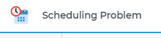

Adding a Logo to an AIMMS WebUI App
====================================

.. meta::
   :description: Add a logo to the header of an AIMMS WebUI application with a theming stylesheet: place the image, set the CSS variables --bg_app-logo and --spacing_app-logo_width, and size the logo.
   :keywords: WebUI, logo, CSS, theming, app branding, header, --bg_app-logo, --spacing_app-logo_width, app-resources, stylesheet

Introduction
------------

The WebUI shows an application logo at the top left of the window, to the left of the application name, when you set it in a theming stylesheet. This article shows how. The feature is available in AIMMS 4.85 and newer.

|

The image above comes from the `Employee Scheduling <https://how-to.aimms.com/Articles/387/387-employee-scheduling.html>`_ example. You can use that example to try the steps below.

Adding the logo
---------------

#. Put the logo image in the folder ``MainProject\WebUI\resources\images`` of your project, for example ``app-logo.svg``.

#. Create a stylesheet in the folder ``MainProject\WebUI\resources\stylesheets``, for example ``theming.css``, with the following contents:

   .. code-block:: css

      /* Application logo in the header, left of the application name.
         --bg_app-logo : <left offset> <vertical position> / <width> <height> no-repeat url(<image>)
         --spacing_app-logo_width : the space reserved for the logo; without it, no logo is shown.
         /app-resources/ maps to the MainProject/WebUI folder. */
      :root {
        --bg_app-logo: 8px 50% / 32px 32px no-repeat url(/app-resources/resources/images/app-logo.svg);
        --spacing_app-logo_width: 48px;
      }

#. Reload the WebUI.

Sizing the logo
---------------

* **Reserve the space.** Without ``--spacing_app-logo_width``, no logo is shown. Make it at least the left offset plus the logo width, here 8 + 32 = 40 pixels. The example reserves 48 pixels, to leave a margin to the application name.
* **Keep the aspect ratio** of the image. A square logo can be shown at 32 x 32 pixels. A wide logo of 435 x 96 pixels (ratio 4.53 : 1) is shown at 145 x 32 pixels, with ``--spacing_app-logo_width`` of at least 8 + 145 = 153 pixels.
* **Keep it sharp.** An SVG image stays sharp at any size. For a PNG image, use two or three times the displayed size, so the logo stays sharp on high-resolution screens.
* **Mind the header.** The height of the header limits the height of the logo.
* **The path.** ``/app-resources/`` maps to the folder ``MainProject\WebUI``. That is why the path to the image contains ``resources/images``.

For more options, see `A special case: the application logo <https://documentation.aimms.com/webui/theming.html#a-special-case-the-application-logo>`_ in the WebUI documentation.

.. seealso::

   * :doc:`../718/718-winui-to-webui`: when you convert a WinUI application, the logo of the WinUI splash screen moves to the WebUI header.
   * :doc:`../518/518-add-logo-to-webui-app-481`, for AIMMS 4.84 and older (deprecated).

.. spelling:word-list::

   app
   png
   svg
   css
   theming
   stylesheet
