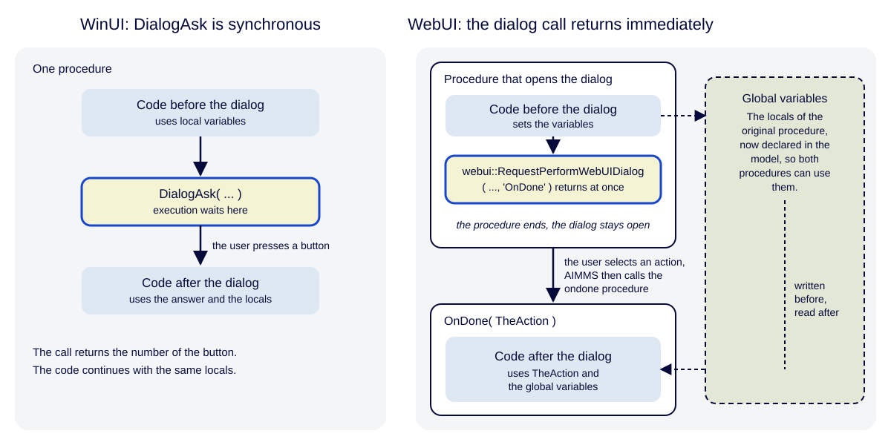

Tips and Tricks Converting a WinUI Application to WebUI
=======================================================

.. meta::
   :description: Tips for converting an AIMMS WinUI application to WebUI: convert dialogs that wait for the user, present many messages as structured notifications, report progress in both WinUI and WebUI, and remove the WinUI splash screen and add a logo to the WebUI.
   :keywords: WinUI to WebUI, AIMMS WebUI, splash screen, startup bitmap, application logo, theming, progress message, DialogProgress, SetProgressMessage, notifications, libw2w

Introduction
------------

The ``WinUI_to_WebUI`` converter converts the pages of a WinUI application, and SENSAI helps to refine them. See :doc:`711-winui-to-webui`. Some parts of a WinUI application are not pages, though: a splash screen, progress windows, and message dialogs. This article gives tips for these parts:

* Converting dialogs that wait for the user, and what to do when the dialogs form a workflow.
* Presenting many messages as a structured list of notifications.
* Reporting progress in both WinUI and WebUI.
* Removing the WinUI splash screen, and adding a logo to the WebUI.

Each tip is a change like any other in the conversion process: make it, check it, and store it in git or a backup copy.

.. _w2w-tips-dialogs:

Converting Dialogs That Wait for the User
-----------------------------------------

In WinUI, the dialog functions :aimms:func:`DialogAsk` and :aimms:func:`DialogMessage` are synchronous. The execution stops at the call, and continues after the user presses a button. The code after the call can use the answer, and all local variables of the procedure.

In WebUI, the corresponding procedure ``webui::RequestPerformWebUIDialog`` returns immediately. The dialog is shown in the browser, but the procedure that called it just continues, and typically ends. Only when the user selects an action, AIMMS calls a second procedure, the *ondone* procedure, with the name of the selected action as its argument. See the `WebUI library <https://documentation.aimms.com/webui/library.html#requestperformwebuidialog>`__.

You can try the example in this project: :download:`AIMMS 26.8 project download <model/DialogWinUIWebUI.zip>` 

An example in WinUI. The local parameter ``p_count`` is used both before and after the dialog:

.. code-block:: aimms

   Procedure pr_deletePlants {
       Body: {
           p_count := Count( i_plant | bp_selected( i_plant ) ) ;

           if DialogAsk(
               formatString( "Delete %i plants?", p_count ),
               "Delete", "Cancel", "Delete plants" ) = 1
           then
               pr_deleteSelectedPlants ;
               sp_status := formatString( "%i plants deleted", p_count ) ;
           endif ;
       }
   }

The same function in WebUI. The code after the dialog moved to ``pr_deletePlantsDone``, and ``p_count`` became a global parameter:

.. code-block:: aimms

   Procedure pr_deletePlants {
       Body: {
           p_count := Count( i_plant | bp_selected( i_plant ) ) ;

           webui::RequestPerformWebUIDialog(
               title   : "Delete plants",
               message : formatString( "Delete %i plants?", p_count ),
               actions : s_deleteActions,   ! the set { Delete, Cancel }
               onDone  : 'pr_deletePlantsDone' ) ;
       }
   }

   Procedure pr_deletePlantsDone {
       Arguments: (sp_action);
       Body: {
           if sp_action = "Delete" then
               pr_deleteSelectedPlants ;
               sp_status := formatString( "%i plants deleted", p_count ) ;
           endif ;
       }
   }

To convert a dialog call:

#. Replace the call by ``webui::RequestPerformWebUIDialog``. The buttons become the elements of the ``actions`` set, in the order of the buttons.

#. Create the ondone procedure, with one input string argument. Move all code after the dialog call to this procedure. Where the WinUI code tested the number of the button, test the name of the action instead.

#. Make every local identifier that is used both before and after the dialog global, so the ondone procedure can read it. Declare it in the model, and give it a clear name, because it now lives as long as the application.

#. Make sure the calling procedure does nothing after the dialog call that depends on the answer. This includes the code of the procedures that called it: when they continue right after the call, they continue before the user has answered.

To only show a message, as with ``DialogMessage``, use a single action such as ``OK`` and pass an empty string as ondone procedure. No procedure is called then.

A few things to look out for:

* A dialog in a loop, or several dialogs in a row, becomes a chain of ondone procedures. The ondone procedure of the first dialog opens the second one, and so on.
* Only one dialog can be open at a time. Before opening a dialog, check ``webui::IsWebUIDialogOpen``, or the number of waiting requests ``webui::RequestQueueSize``.
* In WinUI, pressing Esc or closing the dialog counts as pressing the last button. Check what the WebUI dialog does in that case, and put the safe action, usually Cancel, last.

When a dialog is complicated
~~~~~~~~~~~~~~~~~~~~~~~~~~~~

For a single dialog, the steps above are all you need. Some applications are more complicated: the user goes through several dialogs in a row, and the code decides from the data which of them to show. Converting such a chain into ondone procedures works, but the result is hard to read and to maintain. Two alternatives are often better:

#. **Redesign the dialogs as a workflow.** When each dialog asks the user for a decision, or for input, that belongs to a step of the process, make that step a page in a workflow panel. The user then sees where they are in the process, and can go back. See `AIMMS Workflow Panel <https://documentation.aimms.com/webui/workflow-panels.html#workflow-panels>`__.

#. **Replace informational dialogs by notifications.** Many dialogs do not ask for a decision at all. They only inform the user, for example:

   * about exceptional input, such as data errors, or
   * about exceptional output, such as an unexpected result of an optimization.

   Present these as notifications, as described in the next section, and keep dialogs only for decisions.

.. _w2w-tips-notifications:

Presenting Many Messages as Notifications
-----------------------------------------

Many dialogs only inform the user, and do not ask for a decision. For those, use notifications instead of dialogs.

WinUI applications often report findings one by one, for example with a message dialog per problem found during a data check. With a few messages, that works. With many messages, the user clicks through a series of dialogs, and the information is gone once the dialog is closed.

In that case, collect the messages in a list of notifications, and present that list on a page in the WebUI. A notification library does this. Instead of a dialog, the model calls one procedure per finding:

.. code-block:: aimms

   nml::pr_addNotification(
       sp_message       : "Capacity of plant P1 is negative",
       ep_severity      : 'warning',
       bp_preventsSolve : 1,
       ep_page1         : 'plant_data',
       ep_page2         : '');

Each notification has:

* a message,
* a severity: ``info``, ``warning`` or ``error``,
* whether it likely prevents a successful solve, and
* up to two pages where the user can fix the cause.

The library shows the notifications in a table. The user can show all notifications or only the unhandled ones, mark a notification as handled, delete it, and open the related page directly from the table row.

.. TODO: Add the download location of the notification manager library, and a screenshot of the notifications table.

To switch to notifications:

#. Add the notification library to the project.

#. Replace the message dialogs that report findings by calls to ``nml::pr_addNotification``. Keep a dialog where the user must make a decision before the computation can continue. See :ref:`w2w-tips-dialogs` for how to convert such a dialog.

#. Add a page with the notifications table, and make it easy to reach, for example as a step in the workflow panel.

Reporting Progress in WinUI and WebUI
-------------------------------------

Many WinUI applications report the progress of a long computation with :aimms:func:`DialogProgress`, which shows a progress window with a message and a percentage. In WebUI, the counterpart is ``webui::SetProgressMessage``, which shows a message while the WebUI waits for the computation. See the `WebUI library <https://documentation.aimms.com/webui/library.html>`__.

When the model reports progress regularly, and you want to keep the WinUI version working during the conversion, use the small library ``libw2w``. Its procedure ``w2w::pr_DialogProgress`` has the same arguments as ``DialogProgress``:

* In WinUI mode, it calls ``DialogProgress( message, percentage )``.
* In WebUI mode, it calls ``webui::SetProgressMessage`` with the message, the percentage, and a bar of ten blocks, for example ``Solving 40% [████______]``.

The library also provides the flags ``w2w::bp_useWebUI`` and ``w2w::bp_useWinUI``, which you can use for other code that differs between WinUI and WebUI.

.. TODO: Add the download location of libw2w.

To use the library:

#. Add ``libw2w`` to the project, for example with :menuselection:`File > Library Manager`. When the project is in git, you can add the library as a git submodule, so updates of the library are easy to take over.

#. Replace each call ``DialogProgress(`` by ``w2w::pr_DialogProgress(``. This is a typical routine change to ask SENSAI for:

   .. code-block:: none

      In all procedures of the model and its libraries, replace each call to DialogProgress by a call to w2w::pr_DialogProgress, with the same arguments.

#. Set ``w2w::bp_useWebUI := 1`` when the application runs in the WebUI. The flag is 0 by default, so the application starts in WinUI mode. A suitable place is the procedure that runs when the WebUI loads its first page: in the WebUI, open the page settings of the home page, and set the procedure upon load, for example:

   .. code-block:: aimms

      Procedure pr_openHomePage {
          Body: {
              w2w::bp_useWebUI := 1 ;
              webui::OpenPage( 'first_page' );
          }
      }

Removing the Splash Screen and Adding a Logo
--------------------------------------------

Removing the WinUI splash screen
~~~~~~~~~~~~~~~~~~~~~~~~~~~~~~~~

AIMMS shows a `startup bitmap <https://documentation.aimms.com/user-guide/aimms-ide/Aimms/Miscellaneous/AIMMS%20Files/Startup_Bitmap.html>`_ as splash screen when it starts with a project: a file ``<project-name>.bmp`` in the project folder. For a project ``MyApp.aimms``, that is ``MyApp.bmp``. The splash screen belongs to the desktop application. In a WebUI application, users see the application in their web browser, and the logo belongs in the WebUI itself.

To stop AIMMS from showing the splash screen, rename the bitmap, for example to ``MyApp-winui-logo.bmp``:

#. Rename the file in the project folder.

#. Search the WinUI pages and templates for the old file name, for example in the ``.xml`` files below ``MainProject\Pages`` and ``MainProject\Templates``, and in the libraries. WinUI pages and templates often show the same bitmap as a logo. Point them to the new name, so the WinUI version keeps working while you convert.

#. Check that WebUI image widgets do not use the old file. These widgets use their own copy below ``MainProject\WebUI\resources\images``, so renaming the bitmap in the project folder does not affect them.

When the WinUI version is no longer needed, you can remove the bitmap altogether.

.. tip::

   While you convert, set the AIMMS option ``Open_WebUI_on_Startup`` to ``1``. AIMMS Developer then opens the WebUI as soon as the project is opened.

Adding a logo to the WebUI
~~~~~~~~~~~~~~~~~~~~~~~~~~

The WebUI shows an application logo at the top left of the window, to the left of the application name, when you set it in a theming stylesheet. See `A special case: the application logo <https://documentation.aimms.com/webui/theming.html#a-special-case-the-application-logo>`_.

#. Put the logo image in ``MainProject\WebUI\resources\images``, for example ``logo.png``.

#. Create a stylesheet in ``MainProject\WebUI\resources\css``, for example ``theming.css``:

   .. code-block:: css

      /* Application logo in the header, left of the application name.
         --bg_app-logo : <left offset> <vertical position> / <width> <height> no-repeat url(<image>)
         --spacing_app-logo_width : the space reserved for the logo; without it, no logo is shown.
         /app-resources/ maps to the MainProject/WebUI folder. */
      :root {
        --bg_app-logo: 15px 50% / 145px 32px no-repeat url(/app-resources/resources/images/logo.png);
        --spacing_app-logo_width: 161px;
      }

#. Reload the WebUI.

Keep the following in mind:

* Without ``--spacing_app-logo_width``, no logo is shown. Make it at least the left offset plus the logo width, here 15 + 145 = 160 pixels.
* Keep the aspect ratio of the image. For an image of 435 x 96 pixels (ratio 4.53 : 1), a displayed size of 145 x 32 pixels does not stretch the logo.
* Use an image of two or three times the displayed size, so the logo stays sharp on high-resolution screens.
* The height of the header limits the height of the logo.
* ``/app-resources/`` maps to the folder ``MainProject\WebUI``. That is why the path contains ``resources/images``.

Summary
-------

* Convert a dialog that waits for the user by moving the code after the dialog to an ondone procedure, and by making the shared local identifiers global.
* Collect many messages as notifications in a table, instead of a series of dialogs.
* Use ``libw2w`` to report progress in both WinUI and WebUI with a single call.
* Rename the WinUI startup bitmap to stop the splash screen, and show the logo in the WebUI header with a theming stylesheet.

.. seealso::

   * :doc:`711-winui-to-webui`
   * :doc:`711-operating-winui-to-webui-converter`
   * `WebUI theming <https://documentation.aimms.com/webui/theming.html>`_

.. spelling:word-list::

   WinUI
   WebUI
   webui
   aimms
   libw2w
   w2w
   nml
   SENSAI
   bmp
   png
   css
   theming
   stylesheet
   submodule
   ondone
