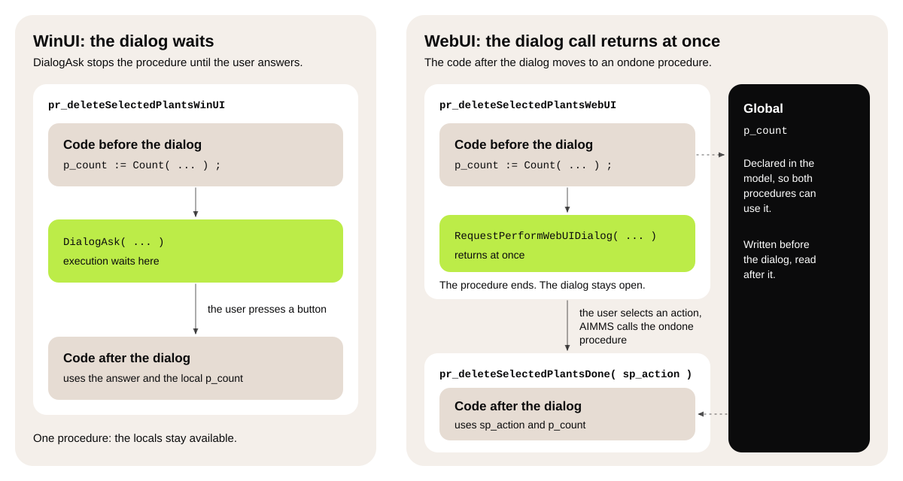

Converting a WinUI Application to WebUI
=======================================

.. meta::
   :description: Convert an AIMMS WinUI application to WebUI: run the WinUI_to_WebUI converter, refine each page by hand, with SENSAI, or with SENSAI skills, and convert dialogs, messages, progress reporting and the splash screen.
   :keywords: WinUI to WebUI, AIMMS WebUI, WinUI migration, conversion process, SENSAI, SENSAI skills, workflow panel, secondary actions, page actions, WorkflowSteps, WorkflowDefinitions, dialogs, RequestPerformWebUIDialog, notifications, DialogProgress, SetProgressMessage, libUITools, splash screen, startup bitmap, application logo, theming

Introduction
------------

Today, most applications run on a server, and people use them through a web browser. That is why AIMMS introduced WebUI more than a decade ago. Since then, AIMMS has supported both WinUI and WebUI side by side. Future AIMMS releases will no longer support WinUI, so now is the time to convert existing applications to WebUI.

Converting an application combines three things:

* **Traditional programming.** The ``WinUI_to_WebUI`` converter does the bulk of the work. It converts every WinUI page automatically into a WebUI page, with the same widgets and the same layout.
* **Artificial intelligence.** SENSAI, the AI built into AIMMS, handles the routine refinements, such as replacing the WinUI navigation by a workflow panel, and tidying up each page.
* **Human judgment.** You, as the developer, keep the final say: you decide what looks right and what your users need.

This way, you can convert an existing WinUI application to WebUI quickly, without losing control over the result.

This article describes the conversion process, the SENSAI skills for converted applications, and tips for the parts of a WinUI application that are not pages, such as dialogs and the splash screen. How to run the converter itself, and which options it has, is described in :doc:`../711/711-operating-winui-to-webui-converter`.

Prerequisites
-------------

* AIMMS Developer 26.8, with a license. The converter is tested with AIMMS 26.8.1.2.
* ``WinUI_to_WebUI.exe``. See :doc:`../711/711-operating-winui-to-webui-converter`.
* Access to an AIMMS Cloud with SENSAI activated, to make changes with SENSAI. Without SENSAI, you can still convert the application and make all changes by hand. See :doc:`../714/714-hello-world-sensai-apps` for how to connect AIMMS Developer to SENSAI.
* The SENSAI skills you want to apply. See :ref:`w2w-skills`.
* A way to store each step: git, recommended, or a backup copy of the project folder per step.

  The converter and SENSAI both modify files in the project folder, such as the model ``.ams`` files and ``webui.json``. Storing each step lets you compare a page before and after a change, and go back when a change does not work out. With git, each commit message documents what you changed, so you can easily find a version that worked, and see how you got there. Make sure the project files are really tracked: git does not store a folder listed in ``.gitignore``.

Downloads
~~~~~~~~~

All downloads are AIMMS 26.8 projects.

.. grid:: 1 1 3 3
   :gutter: 2

   .. grid-item-card:: :octicon:`desktop-download` Original app
      :text-align: center

      Data Reconciliation in WinUI, before the conversion.
      +++
      :download:`Download zip <model/winui-data-reconciliation.zip>`

   .. grid-item-card:: :octicon:`browser` Converted app
      :text-align: center

      The same application in WebUI, after the conversion. See :ref:`w2w-example`.
      +++
      :download:`Download zip <model/webui-data-reconciliation.zip>`

   .. grid-item-card:: :octicon:`comment-discussion` Dialogs
      :text-align: center

      A dialog in WinUI and in WebUI. See :ref:`w2w-tips-dialogs`.
      +++
      :download:`Download zip <model/DialogWinUIWebUI.zip>`

.. tip::

   The tips on :ref:`notifications <w2w-tips-notifications>` and :ref:`progress <w2w-tips-progress>` use the toolkit library ``libUITools``. Download it from :doc:`../717/717-ui-tools-library`.

The Conversion Process
----------------------

A conversion consists of a single automatic step, followed by an iterative refinement:

#. **Apply the converter** to the whole project.

#. **Iterate** until the WebUI application is ready:

   #. **Evaluate** the current WebUI pages. Compare them with the original WinUI pages, and decide what to improve next.

   #. **Apply a change**, to a single page or to a group of pages, by hand or with SENSAI. See :ref:`w2w-kinds-of-change`.

   #. **Store** the result.

Each iteration refines the result of the previous one. Store the WinUI version before you start, and store the result of every step.

Step 1: Apply the converter
~~~~~~~~~~~~~~~~~~~~~~~~~~~

Run ``WinUI_to_WebUI`` in the project folder, as described in :doc:`../711/711-operating-winui-to-webui-converter`. The converter:

* converts all WinUI pages into WebUI pages, with the same widgets and the same layout,
* keeps the tree structure of the pages: the WebUI page tree has the same parent and child pages as the WinUI Page Manager, so your users find each page where they expect it,
* adds the identifiers the WebUI pages need to a generated module in the main model and in each library, and
* writes a conversion log, ``<project>_conversion.md``, which lists the objects it could not convert.

Open the project in AIMMS, check that the model compiles, and open the WebUI. Store this first converted version. It is the starting point for all later steps.

.. warning::

   Running the converter again on the whole project rebuilds ``webui.json`` from scratch, and discards all changes made afterwards, by hand or with SENSAI. To reconvert a single page later, use the ``--page`` option. It leaves all other pages unchanged.

Step 2: Evaluate the current interface
~~~~~~~~~~~~~~~~~~~~~~~~~~~~~~~~~~~~~~

Open the converted pages in the WebUI, and compare them with the original WinUI pages. Typical points to look for:

* WinUI navigation, such as buttons that only open another page. WebUI offers a workflow panel and a menu for this. This point concerns a group of pages, often the whole application.
* Buttons that start an action. In WebUI, these usually fit better in the page actions menu at the bottom right of the page.
* Empty grid rows and columns, and widgets that use the screen space poorly.
* Text that does not fit, such as table headers that are cut off.
* Objects listed in the conversion log as not converted.
* Parts of the application that are not pages, such as dialogs, progress windows and the splash screen. See :ref:`w2w-beyond-pages`.

Pick one improvement at a time. Small steps are easier to review and easier to undo. Start with the changes that concern a group of pages, such as the workflow panel, and then refine the pages one by one.

Step 3: Apply changes
~~~~~~~~~~~~~~~~~~~~~

Apply the improvement you chose. Decide first how to make it: by hand for a change that takes judgment on a single page, with a SENSAI instruction for a routine change, or with a SENSAI skill for a recurring task that has a skill. The next section describes these kinds of change.

Step 4: Store the changes
~~~~~~~~~~~~~~~~~~~~~~~~~

When you are satisfied with the change, store it, and describe in one line what you changed, for example "Run reconciliation page: replace navigation buttons by workflow panel". When you are not satisfied, go back to the stored version, and try another way.

Then return to Step 2 for the next improvement, or the next page.

.. _w2w-kinds-of-change:

Kinds of Change
---------------

There are three ways to make a change. A manual change applies to a single page. A change made with SENSAI, with or without a skill, applies to a single page or to a group of pages, for example all pages below a parent page.

Manual changes
~~~~~~~~~~~~~~

Some changes take human judgment, and are best made by hand, on a single page, in the WebUI editor or in the model. For example:

* combining related values, such as a model status and an error measure, in one KPI widget, and
* widening table columns, so that the headers are fully visible.

Asking SENSAI for an improvement
~~~~~~~~~~~~~~~~~~~~~~~~~~~~~~~~

For routine changes, give SENSAI a simple instruction in the SENSAI chat in AIMMS Developer, for a single page or for a group of pages. For example:

.. code-block:: none

   On page "Run reconciliation model", eliminate the empty columns and rows.

.. code-block:: none

   On all pages, move the "This Section" widgets to Unassigned widgets.

Moving a widget to **Unassigned widgets** removes it from the page without deleting it. You can drag it back in the WebUI editor later.

Review what SENSAI changed before you store it. When an instruction concerns a group of pages, check a few of those pages.

.. _w2w-skills:

Asking SENSAI to apply a skill
~~~~~~~~~~~~~~~~~~~~~~~~~~~~~~

A SENSAI skill is a reusable set of instructions for a recurring task. A skill makes the result predictable: SENSAI follows the same procedure every time, checks its own work, and reports what it changed.

Two skills are available for converted applications:

.. _w2w-skill-workflow-panel:

.. card:: :octicon:`list-ordered` Workflow Panel

   ``aimms-workflow-panel``

   WinUI applications often navigate with buttons that open another page. After conversion, these buttons are still on the WebUI pages, even though WebUI offers a better way: a workflow panel, a step navigation on the left side of the page. This skill builds that panel from the page tree, for a parent page you choose and the pages below it.

.. tab-set::

   .. tab-item:: Apply

      Ask SENSAI in the chat:

      .. code-block:: none

         Apply skill aimms-workflow-panel.

      After the skill has finished, open the WebUI on one of the workflow pages, and check that the workflow panel shows all steps, and that the pages still work.

   .. tab-item:: What it does

      #. It shows the page tree, and asks you which page is the parent page, and which title the workflow gets.
      #. The child pages of the parent page become the steps of the workflow. Their own child pages become child steps.
      #. It adds the string parameters ``WorkflowDefinitions`` and ``WorkflowSteps`` to the model, and sets the workflow in the application settings of ``webui.json``.
      #. It moves the buttons that only open another page to **Unassigned widgets** of their page. Buttons that run a model procedure stay where they are. For buttons it cannot classify, it asks you.

   .. tab-item:: Limits

      * A workflow panel has one level of child steps. Pages deeper in the tree are not shown in the panel; the skill reports them.
      * AIMMS recommends at most 10 top-level steps, and at most 10 child steps per step.
      * Empty grid columns left behind by the moved buttons are not removed. Ask SENSAI to remove them in a next step.
      * The ``home`` page is not a workflow step. The workflow panel is not shown there.

.. _w2w-skill-secondary-actions:

.. card:: :octicon:`kebab-horizontal` Buttons to Secondary Actions

   ``buttons-to-secondary-action``

   On WinUI pages, buttons that start an action, such as solving the model or printing a report, are placed on the page itself. In WebUI, these actions usually fit better in the page actions menu at the bottom right of the page, the secondary actions. This skill moves some or all buttons of a single page to that menu. To handle a group of pages, ask SENSAI to apply it to each of them.

.. tab-set::

   .. tab-item:: Apply

      Ask SENSAI in the chat, for example:

      .. code-block:: none

         Apply skill buttons-to-secondary-action to page "Run reconciliation model", for all buttons.

      After the skill has finished, check in the WebUI that the buttons are gone from the page, that the page actions menu shows the new actions with the right icons, and that each action runs its procedure.

   .. tab-item:: What it does

      #. It lists the buttons of the page, with the procedure each button runs.
      #. It asks which buttons to move, if you did not say so, and chooses an icon for each of them.
      #. It moves the chosen buttons to **Unassigned widgets** of the page.
      #. It adds a string parameter, by default ``sp_<page>_secondary_actions``, to the model, with a display text, icon, procedure and state for each action, and sets it as the secondary actions of the page in ``webui.json``.

   .. tab-item:: Limits

      * A secondary action has a display text, an icon, a procedure and a state (active, inactive or hidden). Other button options, such as a title or visibility bound to model data, are not carried over. The skill reports such buttons, so you can decide how to handle them.
      * A button without a procedure, for example one that only opens another page, cannot become a secondary action. Use the :ref:`workflow panel skill <w2w-skill-workflow-panel>` for navigation buttons.
      * The WebUI shows at most 10 secondary actions per page. AIMMS recommends about five.

.. seealso::

   * The skill files are in the folder `sensai/skills <https://github.com/aimms/winui-to-webui/tree/main/sensai/skills>`_ of the converter repository, one Markdown file per skill. Copy them to the folder ``sensai/skills`` in your project folder. SENSAI uses the project skills in that folder since AIMMS 26.5, and they are versioned together with the application. Both skills are tested with AIMMS 26.8 and WebUI library 26.13.
   * :doc:`../309/309-workflow-panel-element-and-string-parameters`
   * :doc:`../295/295-convert-page-actions`

**What every skill does before and after a change**

* **Before:** it checks whether the project is tracked by git. If it is, it asks you to commit open changes first. If it is not, it keeps backup copies of ``webui.json`` and the model ``.ams`` file.
* **Preview:** it shows what it is going to change, and asks you to confirm.
* **No deletes:** a widget it moves goes to **Unassigned widgets**, and can be dragged back to the page in the WebUI editor.
* **After:** it checks the result, reports what it changed, and offers to commit it.

.. tip::

   Do not save from the WebUI editor while SENSAI is editing ``webui.json``. The WebUI rewrites that file when it saves, and may overwrite the changes of SENSAI.

When you make the same manual change on several pages, consider asking SENSAI to turn it into a skill of your own. See :doc:`../714/714-hello-world-sensai-apps`.

.. _w2w-example:

Example
-------

The Data Reconciliation application shows the process on a single page, **Run reconciliation model**.

#. **The original WinUI page.** On the left are the navigation buttons. On the right are an introduction text, the settings and buttons to run the model, and a table of observed errors.

   .. image:: images/718-example-1-winui.png
      :align: center
      :alt: The original WinUI page Run reconciliation model, with navigation buttons on the left and settings, run buttons and an error table on the right.

   |

#. **After the converter.** ``WinUI_to_WebUI`` converted the page to a WebUI page with the same widgets and the same layout. The page tree on the left has the same structure as in WinUI. The WinUI navigation buttons came along as well, even though WebUI does not need them.

   .. image:: images/718-example-2-converter.png
      :align: center
      :alt: The same page after the converter: a WebUI page with the same widgets and layout, and the WinUI navigation buttons still on it.

   |

#. **After the workflow panel skill.** SENSAI applied the skill ``aimms-workflow-panel``. A workflow panel now shows all steps of the application in one place. The navigation buttons moved to **Unassigned widgets**, and the page uses the full width.

   .. image:: images/718-example-3-workflow-panel.png
      :align: center
      :alt: The page after the workflow panel skill: a workflow panel on the left, and the navigation buttons gone from the page.

   |

#. **After asking SENSAI to tidy up.** SENSAI eliminated the empty columns and rows, and moved the "This Section" widgets to **Unassigned widgets**. The page uses the screen space better.

   .. image:: images/718-example-4-tidy.png
      :align: center
      :alt: The page after SENSAI tidied it up: no empty rows and columns, and the This Section widgets gone.

   |

#. **After tuning a page.** SENSAI applied the skill ``buttons-to-secondary-action``, which moved the buttons to the page actions menu. By hand, the model status and the observed error are combined in one KPI widget, and the table columns are widened, so the headers are fully visible.

   .. image:: images/718-example-5-manual.png
      :align: center
      :alt: The page after tuning: the buttons in the page actions menu, one KPI widget for model status and error, and wider table columns.

   |

#. **Finishing touch.** A logo in the upper left, as described in :ref:`w2w-tips-logo`. The change adds a small SVG logo, ``resources/images/app-logo.svg``, and a theme file, ``resources/css/logo-theme.css``, that sets ``--bg_app-logo`` (the image, its position and size) and ``--spacing_app-logo_width`` (the space reserved for it). Both live in the ``MainProject/WebUI`` folder, and you select the theme in the WebUI settings.

   .. image:: images/718-example-6-finishing-touch.png
      :align: center
      :alt: The final page, with the application logo in the upper left.

   |

The result is a clean WebUI page that does the same as the original WinUI page.

.. _w2w-beyond-pages:

Beyond the Pages
----------------

The converter converts the pages of a WinUI application, and SENSAI helps to refine them. Some parts of a WinUI application are not pages, though: message dialogs, progress windows, and a splash screen. This section gives tips for these parts. Each tip is a change like any other in the conversion process: make it, check it, and store it.

.. list-table::
   :header-rows: 1
   :widths: 30 40 30

   * - In WinUI
     - In WebUI
     - Tip
   * - ``DialogAsk``, ``DialogMessage``
     - ``webui::RequestPerformWebUIDialog`` and an ondone procedure
     - :ref:`w2w-tips-dialogs`
   * - Many message dialogs, one per finding
     - A list of notifications, with ``libUITools``
     - :ref:`w2w-tips-notifications`
   * - ``DialogProgress``
     - ``webui::SetProgressMessage``, or ``uit::pr_DialogProgress`` for both
     - :ref:`w2w-tips-progress`
   * - Splash screen, ``<project-name>.bmp``
     - Application logo in the header, set in a stylesheet
     - :ref:`w2w-tips-splash`

.. _w2w-tips-dialogs:

Converting dialogs that wait for the user
~~~~~~~~~~~~~~~~~~~~~~~~~~~~~~~~~~~~~~~~~

In WinUI, the dialog functions :aimms:func:`DialogAsk` and :aimms:func:`DialogMessage` are synchronous. The execution stops at the call, and continues after the user presses a button. The code after the call can use the answer, and all local variables of the procedure.

In WebUI, the corresponding procedure ``webui::RequestPerformWebUIDialog`` returns immediately. The dialog is shown in the browser, but the procedure that called it just continues, and typically ends. Only when the user selects an action, AIMMS calls a second procedure, the *ondone* procedure, with the name of the selected action as its argument. See the `WebUI library <https://documentation.aimms.com/webui/library.html#requestperformwebuidialog>`__.

You can try the example in this project: :download:`AIMMS 26.8 Dialogs in WinUI and WebUI <model/DialogWinUIWebUI.zip>`.

|

The example project contains both versions of the same procedure:

.. tab-set::

   .. tab-item:: WinUI

      ``pr_deleteSelectedPlantsWinUI`` asks for confirmation, and the local parameter ``p_count`` is used both before and after the dialog:

      .. code-block:: aimms

         Procedure pr_deleteSelectedPlantsWinUI {
             Body: {
                 p_count := Count( i_plant | bp_deleteThisPlant( i_plant ) ) ;

                 if DialogAsk(
                     formatString( "Delete %i plants?", p_count ),
                     "Delete", "Cancel", "Delete plants" ) = 1
                 then
                     pr_deleteSelectedPlants ;
                     sp_status := formatString( "%i plants deleted", p_count ) ;
                     StatusMessage( sp_status );
                 endif ;
             }
             Parameter p_count;
         }

   .. tab-item:: WebUI

      In WebUI, ``pr_deleteSelectedPlantsWebUI`` only opens the dialog. The code after the dialog moved to the ondone procedure ``pr_deleteSelectedPlantsDone``, and ``p_count`` became a global parameter, declared in the section ``Globals_for_delete_selected_plants_dialogue``. The status message is shown with ``webui::ShowMessage``:

      .. code-block:: aimms

         Procedure pr_deleteSelectedPlantsWebUI {
             Body: {
                 p_count := Count( i_plant | bp_deleteThisPlant( i_plant ) ) ;

                 webui::RequestPerformWebUIDialog(
                     title   : "Delete plants",
                     message : formatString( "Delete %i plants?", p_count ),
                     actions : s_deleteActions,   ! the set { Delete, Cancel }
                     onDone  : 'pr_deleteSelectedPlantsDone' ) ;
             }
         }

         Procedure pr_deleteSelectedPlantsDone {
             Arguments: (sp_action);
             Body: {
                 if sp_action = "Delete" then
                     pr_deleteSelectedPlants ;
                     sp_status := formatString( "%i plants deleted", p_count ) ;
                     webui::ShowMessage( 'info', sp_status );
                 endif ;
             }
             StringParameter sp_action {
                 Property: Input;
             }
         }

To convert a dialog call:

#. Replace the call by ``webui::RequestPerformWebUIDialog``. The buttons become the elements of the ``actions`` set, in the order of the buttons.

#. Create the ondone procedure, with one input string argument. Move all code after the dialog call to this procedure. Where the WinUI code tested the number of the button, test the name of the action instead.

#. Make every local identifier that is used both before and after the dialog global, so the ondone procedure can read it. Declare it in the model, and give it a clear name, because it now lives as long as the application.

#. Make sure the calling procedure does nothing after the dialog call that depends on the answer. This includes the code of the procedures that called it: when they continue right after the call, they continue before the user has answered.

To only show a message, as with ``DialogMessage``, use a single action such as ``OK`` and pass an empty string as ondone procedure. No procedure is called then.

.. important::

   * A dialog in a loop, or several dialogs in a row, becomes a chain of ondone procedures. The ondone procedure of the first dialog opens the second one, and so on.
   * Only one dialog can be open at a time. Before opening a dialog, check ``webui::IsWebUIDialogOpen``, or the number of waiting requests ``webui::RequestQueueSize``.
   * In WinUI, pressing Esc or closing the dialog counts as pressing the last button. Check what the WebUI dialog does in that case, and put the safe action, usually Cancel, last.

.. dropdown:: When a dialog is complicated

   For a single dialog, the steps above are all you need. Some applications are more complicated: the user goes through several dialogs in a row, and the code decides from the data which of them to show. Converting such a chain into ondone procedures works, but the result is hard to read and to maintain. Two alternatives are often better:

   #. **Redesign the dialogs as a workflow.** When each dialog asks the user for a decision, or for input, that belongs to a step of the process, make that step a page in a workflow panel. The user then sees where they are in the process, and can go back. See `AIMMS Workflow Panel <https://documentation.aimms.com/webui/workflow-panels.html#workflow-panels>`__.

   #. **Replace informational dialogs by notifications.** Many dialogs do not ask for a decision at all. They only inform the user, for example:

      * about exceptional input, such as data errors, or
      * about exceptional output, such as an unexpected result of an optimization.

      Present these as notifications, as described in the next section, and keep dialogs only for decisions.

.. _w2w-tips-notifications:

Presenting many messages as notifications
~~~~~~~~~~~~~~~~~~~~~~~~~~~~~~~~~~~~~~~~~

Many dialogs only inform the user, and do not ask for a decision. For those, use notifications instead of dialogs.

WinUI applications often report findings one by one, for example with a message dialog per problem found during a data check. With a few messages, that works. With many messages, the user clicks through a series of dialogs, and the information is gone once the dialog is closed.

In that case, collect the messages in a list of notifications, and present that list on a page in the WebUI. The toolkit library :doc:`libUITools <../717/717-ui-tools-library>` does this. Instead of a dialog, the model calls one procedure per finding:

.. code-block:: aimms

   uit::pr_addNotification(
       sp_message       : "Capacity of plant P1 is negative",
       ep_severity      : 'warning',
       bp_preventsSolve : 1,
       ep_page1         : 'plant_data',
       ep_page2         : '');

To switch to notifications:

#. Add ``libUITools`` to the project.

#. Replace the message dialogs that report findings by calls to ``uit::pr_addNotification``. Keep a dialog where the user must make a decision before the computation can continue. See :ref:`w2w-tips-dialogs` for how to convert such a dialog.

#. Add a page with the notifications table, and make it easy to reach, for example as a step in the workflow panel.

.. _w2w-tips-progress:

Reporting progress in WinUI and WebUI
~~~~~~~~~~~~~~~~~~~~~~~~~~~~~~~~~~~~~

Many WinUI applications report the progress of a long computation with :aimms:func:`DialogProgress`, which shows a progress window with a message and a percentage. In WebUI, the counterpart is ``webui::SetProgressMessage``, which shows a message while the WebUI waits for the computation. See the `WebUI library <https://documentation.aimms.com/webui/library.html>`__.

When the model reports progress regularly, and you want to keep the WinUI version working during the conversion, use the procedure ``uit::pr_DialogProgress`` of :doc:`libUITools <../717/717-ui-tools-library>`. It has the same arguments as ``DialogProgress``, and works in both WinUI and WebUI.

#. Add ``libUITools`` to the project.

#. Replace each call ``DialogProgress(`` by ``uit::pr_DialogProgress(``. This is a typical routine change to ask SENSAI for:

   .. code-block:: none

      In all procedures of the model and its libraries, replace each call to DialogProgress by a call to uit::pr_DialogProgress, with the same arguments.

#. Make sure ``uit::bp_useWebUI`` is ``1`` when the application runs in the WebUI, and ``0`` when it runs in WinUI. See :doc:`../717/717-ui-tools-library` for where to set it.

.. _w2w-tips-splash:

Replacing the splash screen by a WebUI logo
~~~~~~~~~~~~~~~~~~~~~~~~~~~~~~~~~~~~~~~~~~~

A WinUI application shows its logo in a splash screen when it starts. A WebUI application shows it in the header of the browser window. The tip has two steps: remove the splash screen, and add the logo to the WebUI.

Step 1: Remove the splash screen
^^^^^^^^^^^^^^^^^^^^^^^^^^^^^^^^

AIMMS shows a `startup bitmap <https://documentation.aimms.com/user-guide/aimms-ide/Aimms/Miscellaneous/AIMMS%20Files/Startup_Bitmap.html>`_ as splash screen when it starts with a project: a file ``<project-name>.bmp`` in the project folder. For a project ``MyApp.aimms``, that is ``MyApp.bmp``. The splash screen belongs to the desktop application. In a WebUI application, users see the application in their web browser, and the logo belongs in the WebUI itself.

To stop AIMMS from showing the splash screen, rename the bitmap, for example to ``MyApp-winui-logo.bmp``:

#. Rename the file in the project folder.

#. Search the WinUI pages and templates for the old file name, for example in the ``.xml`` files below ``MainProject\Pages`` and ``MainProject\Templates``, and in the libraries. WinUI pages and templates often show the same bitmap as a logo. Point them to the new name, so the WinUI version keeps working while you convert.

#. Check that WebUI image widgets do not use the old file. These widgets use their own copy below ``MainProject\WebUI\resources\images``, so renaming the bitmap in the project folder does not affect them.

When the WinUI version is no longer needed, you can remove the bitmap altogether. See also :doc:`../221/221-adding-a-custom-splash-screen`.

.. tip::

   While you convert, set the AIMMS option ``Open_WebUI_on_Startup`` to ``1``. AIMMS Developer then opens the WebUI as soon as the project is opened.

.. _w2w-tips-logo:

Step 2: Add the logo to the WebUI
^^^^^^^^^^^^^^^^^^^^^^^^^^^^^^^^^

The WebUI shows an application logo at the top left of the window, to the left of the application name. You set it with two CSS variables in a theming stylesheet: ``--bg_app-logo`` for the image, its position and size, and ``--spacing_app-logo_width`` for the space reserved for it. See :doc:`../518/518-add-logo-to-webui-app` for the steps and for how to size the logo.

The converted example application uses a square SVG logo, ``resources/images/app-logo.svg``, with the stylesheet ``resources/css/logo-theme.css``, both in the folder ``MainProject/WebUI``.

Summary
-------

To convert a WinUI application to WebUI, run the ``WinUI_to_WebUI`` converter once on the whole project, and then refine the result page by page. In each iteration, evaluate the pages, apply one change to a single page or a group of pages, by hand, with SENSAI, or with a SENSAI skill, and store the result. The converter does the bulk of the work, SENSAI handles the routine refinements, and you keep the final judgment.

For the parts that are not pages:

* Convert a dialog that waits for the user by moving the code after the dialog to an ondone procedure, and by making the shared local identifiers global.
* Collect many messages as notifications in a table, instead of a series of dialogs.
* Use ``libUITools`` to report progress in both WinUI and WebUI with a single call.
* Rename the WinUI startup bitmap to stop the splash screen, and show the logo in the WebUI header with a theming stylesheet.

.. seealso::

   * :doc:`../711/711-operating-winui-to-webui-converter`
   * :doc:`../717/717-ui-tools-library`
   * :doc:`../518/518-add-logo-to-webui-app`
   * :doc:`../714/714-hello-world-sensai-apps`
   * :doc:`../309/309-workflow-panel-element-and-string-parameters`
   * :doc:`../295/295-convert-page-actions`
   * `SENSAI documentation <https://documentation.aimms.com/sensai/index.html>`_
   * `WebUI theming <https://documentation.aimms.com/webui/theming.html>`_

.. spelling:word-list::

   WinUI
   WebUI
   webui
   aimms
   SENSAI
   json
   KPI
   reconvert
   libUITools
   bmp
   png
   css
   theming
   stylesheet
   ondone
